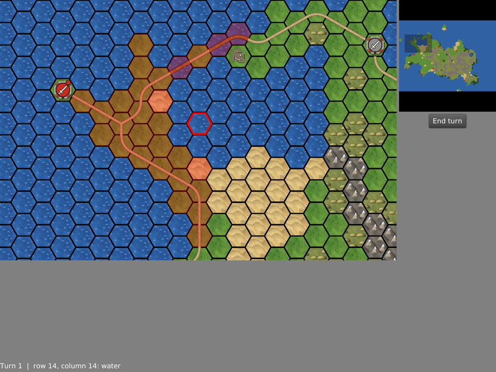
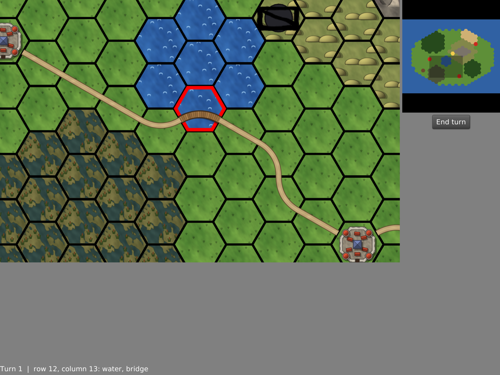

# HexGame

A hex map strategy game foundation in Rust. It is a port of the C++
[hexGame](https://github.com/sstanfield/hexGame) engine demo: a 100 x 100 map of
flat-topped hexes, one unit that can be selected and moved within its movement
range, zoom, and a minimap. The UI is
[Turbo Ferret](https://github.com/sstanfield/turbo-ferret) and the graphics go
through [miniquad](https://github.com/not-fl3/miniquad).



The port is done (`docs/deviations.md` records how it differs from the C++),
and from here the game goes its own way. `hexgame-rust-port-plan.md` has the
direction. So far:

- a [map format](docs/map-format.md) in plain text, for maps of any size and
  shape from 20 x 20 to 600 x 600: terrain, roads with bridges and mountain
  passes, the map's own kinds of unit, its cities with what they build and
  who stands in them, and pictures of its own if it wants them;
- the game plays such a map (`--map`): units of eight sides move over it,
  along its roads, turn by turn. There is no fighting, building or winning yet;
- a [map editor](#the-map-editor) for the terrain and the roads;
- [tiles, roads and unit signs](#the-pictures) drawn by a program in the
  repository, so the art is original and can be made again.

## Build and run

```sh
cargo run
```

Rust 1.86 or newer. The only dependencies are miniquad and Turbo Ferret (fetched
by Cargo from its repository).

- **macOS:** nothing else is needed.
- **Linux:** miniquad needs
  `sudo apt-get install libx11-dev libxi-dev libgl1-mesa-dev libasound2-dev`.
- **Windows:** should build and run the same way; nobody has tried it by hand.

The game uses OpenGL (miniquad's default backend on every desktop platform).

## Controls

| Input | What it does |
|---|---|
| Move the pointer over the map | The hex under it becomes the cursor (red border) |
| Click a hex, or Enter at the cursor | With nothing selected: select the unit on the hex, which shows where it can go (red tint). With a unit selected: move it to the hex if it can reach it, or deselect it if this is its own hex |
| Two fingers on a trackpad, or the mouse wheel, over the map | The map moves with the fingers (a wheel moves it up and down, and sideways with Shift) |
| Drag with the right or the middle button | Pulls the map along with the pointer |
| Ctrl (or Cmd) and the wheel or two fingers | Zoom in and out; what is under the pointer stays under it |
| Click or drag on the minimap | The main map goes to that part of the map (and the cursor with it) |
| Two fingers or the wheel over the minimap | The view goes the same way as over the main map, but much farther: a pixel of the minimap for a pixel of the fingers |
| Arrow keys | Move the cursor; the view follows when the cursor leaves it, and comes back to it if it was moved away |
| `1` / `2` | Zoom out / in, centered on the cursor |
| The End turn button, or Ctrl+T (Cmd+T) | The turn is over: every unit has its movement points back |
| F11 | Fullscreen on and off |
| Ctrl+Q (or Cmd+Q) | Quit |

A unit is a disc in its side's color with the sign of its kind; a city that
has an owner flies a small disc of the owner's color. The line at the bottom
of the window says the turn, and what is on the hex under the cursor: its
terrain and road, its city (name, owner, walls, what it builds), its units
(with the movement points they have left). Every unit can be moved, whoever's
it is: whose turn it is, fighting and building are rules still to come.

## Options

```
hexgame [--map <file.map or map directory>] [--script <steps>] [--assets <dir>] [--frames <n>] [--screenshot <file.png>]
```

- `--map <file.map or map directory>`: play on this map instead of the demo's
  (the format is in `docs/map-format.md`). A map directory brings its own
  units and cities, and the view starts on the first city with a garrison. A
  single terrain file has none: the demo's unit starts on the land nearest
  its middle.
- `--assets <dir>`: where the assets are. Without it: `../assets` next to the
  executable if that exists, else `assets` in the source tree (so `cargo run`
  works).
- `--frames <n>`: draw `n` frames and quit (a smoke test).
- `--screenshot <file.png>`: draw a frame into a PNG file and quit (the last
  frame of `--frames`, or the second). The exit status is 1 if the file could
  not be written.
- `--script <steps>`: play some input before the first frame. Steps are
  separated by commas: `left`, `right`, `up`, `down`, `enter`, `esc`, `space`,
  `1`, `2`, `key:X` (any character; `key:ctrl+s` with modifiers),
  `click:ROW:COL`, `hover:ROW:COL`, `drag:ROW:COL:ROW:COL`, `minimap:ROW:COL`
  (click the minimap there), `press:ID` (click the widget with that id),
  `scroll:DX:DY` (two fingers on the map: it moves that many pixels right and
  down), `miniscroll:DX:DY` (the same on the minimap), `zoomin:ROW:COL` and
  `zoomout:ROW:COL` (Ctrl and the wheel over that hex), `pull:DX:DY` (a drag
  with the right button), `cursor:ROW:COL` (jump there), and `*N` repeats a
  step.

```sh
cargo run -- --screenshot shot.png --script "enter,1,1"     # the unit's range, zoomed out
cargo run -- --screenshot corner.png --script "cursor:0:0"  # the map's top left corner
cargo run -- --map assets/maps/example.map                  # the example island
cargo run -- --map assets/maps/continent                    # a whole map: roads, nine cities, four sides
```

## The map editor

```sh
cargo run -p mapeditor -- assets/maps/mine.map      # edit it, or start it if it is not there
cargo run -p mapeditor -- assets/maps/continent     # a map directory: its terrain and roads
cargo run -p mapeditor -- mine.map --new 60x90      # a new map of 60 rows and 90 columns
cargo run -p mapeditor -- --check assets/maps/*     # what is in these maps, and what is wrong with them
```


The main map and the minimap work as in the game (the pointer, the arrows, `1`
and `2`, two fingers or the wheel, a drag with the right button, a click or a
drag on the minimap). The sidebar chooses what a press on
the map does:

| Input | What it does |
|---|---|
| A terrain button | Choose the terrain to paint with |
| The terrain's letter (`g f h m w s d c t r`) | Choose it and paint at the cursor, which follows the pointer: point and type |
| Press or drag on the map | Paint (a drag leaves no gaps), or fill with the Fill tool |
| Paint / Fill | Paint puts the terrain under the brush; Fill gives it to the hex and every hex of the same terrain connected to it |
| Road / No road | A press lays a road on the hex (over water: a bridge), a drag lays it along the way; No road takes it away. The terrain stays, and new terrain painted under a road leaves the road |
| 1 / 7 / 19, or `[` and `]` | The brush's size in hexes. The larger ones show what they would paint |
| Enter or Space | Use the tool at the cursor |
| Undo / Redo, Ctrl+Z / Ctrl+Shift+Z or Ctrl+Y (Cmd on macOS) | A drag, a fill or a key is one step; 200 steps are kept |
| The File field, Save, Open, Ctrl+S | Save writes the map to the file named in the field, Open reads it. Enter or Esc in a field gives the keys back to the map |
| The two numbers and New | A new map of that many rows and columns, all of the chosen terrain |

Open, New and quitting ask a second time when the map has unsaved changes. The
status line at the bottom shows the map's size, the hex under the cursor, the
tool, the file, and what the last action had to say.

The editor edits the terrain and the roads. Of a map directory that is its
`terrain.map`; the units and the cities are text files, edited as text, and
when the editor saves it says what `cities.txt` has to say about the new
terrain (a city that is no longer on a city tile, a city tile without an
entry). `--check` reads a whole map as the game does and reports on all of it.

It takes the game's `--assets`, `--frames`, `--screenshot` and `--script`
(`--script "press:terrain_w,press:brush_7,click:10:12,key:ctrl+s"`).

## The pictures

```sh
cargo run -p assetgen --release                                # draw the game's pictures again
cargo run -p assetgen --release -- --previews target/previews  # and maps drawn with them, to look at
```

The map's pictures are not drawn by hand: `tools/assetgen` (Rust, no
dependencies) computes them from noise and shapes. The ten terrain tiles in
`assets/tiles`, each running on into its neighbours of the same terrain
without a seam; a road and a bridge in each of the 14 shapes a hex's road can
have, in `assets/roads`; and four signs for units in `assets/units`. So the
art is original, it is under the game's licence and no other, and it can be
made again at any size. [docs/tiles.md](docs/tiles.md) says how each picture
lies in its file and how to change the art. A map can bring pictures of its
own, which are used instead of these.



## Development

```sh
cargo fmt --all --check
cargo clippy --workspace --all-targets -- -D warnings
cargo test --workspace    # needs no GPU and no display
```

The repository is a Cargo workspace: the game at its root, the tools
(`mapeditor`, `assetgen`) under `tools/`. The code is laid out so that almost all of it runs in `cargo test`:
the game state (`src/state`, `src/game.rs`), the view math (`src/view.rs`,
`src/minimap_view.rs`), the geometry the renderers draw (`src/render`), and the
UI with its input (`src/screen.rs`, `src/session.rs` and the editor, driven
headlessly by `tests/` and `tools/mapeditor/tests/`). Only the GPU calls need a
window, and the screenshot mode shows what they draw. `CLAUDE.md`
has the layout and the rules of the repository.

The C++ original is not part of this repository. To read it next to the port:
`git clone https://github.com/sstanfield/hexGame reference/hexGame` (the
directory is gitignored).

### What has been run where

Everything was built, tested and looked at (through screenshots, and a window
resize) on **macOS 15, Apple Silicon, at 2x**, and the owner has run the game's
live window there. The map editor has only been driven by tests and scripted
screenshots: nobody has used its live window yet. **Linux and Windows have not been run**: CI
(`.github/workflows/ci.yml`) builds and tests on all three, and has itself not
run yet. Things to try by hand on each: the mouse (hover, click to select and
move), the keys above, resizing the window, a HiDPI and a plain screen, F11.

## Licences

HexGame is under the zlib licence (`LICENSE`), as the C++ original is.

`NOTICE` lists what it is built on and ships with: Turbo Ferret and Turbo Badger
(zlib), Turbo Badger's default skin in `assets/skin` (public domain), miniquad
(MIT or Apache-2.0), and the built-in font, DejaVu Sans, whose licence notice
has to accompany every copy of the program. The terrain tiles are made by
`tools/assetgen` and are part of the game; the unit picture is the C++ demo's.
