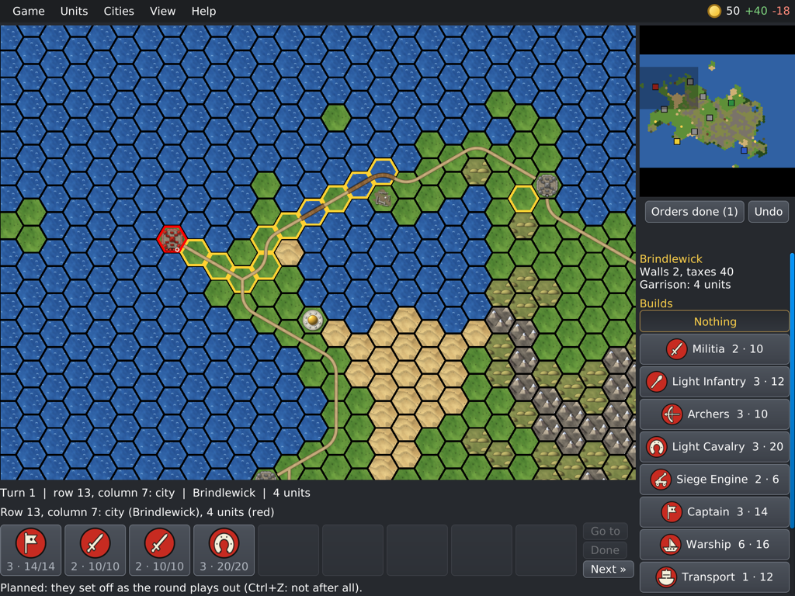
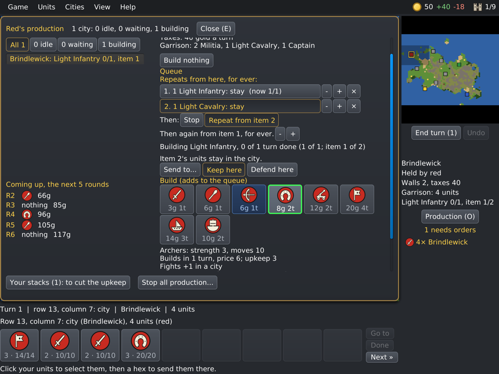
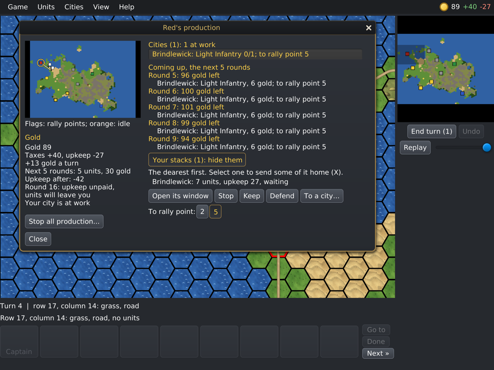
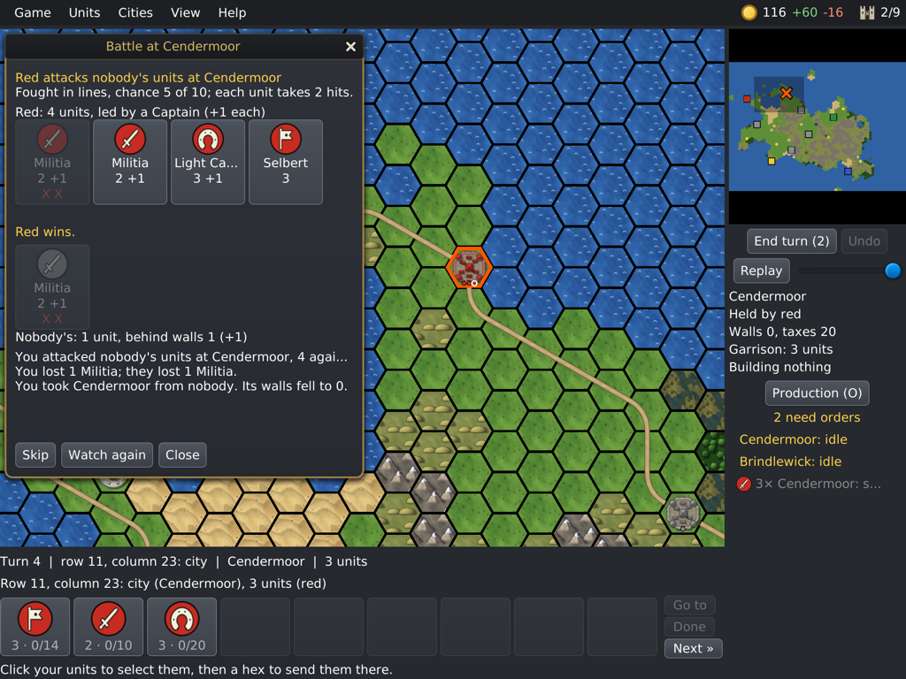
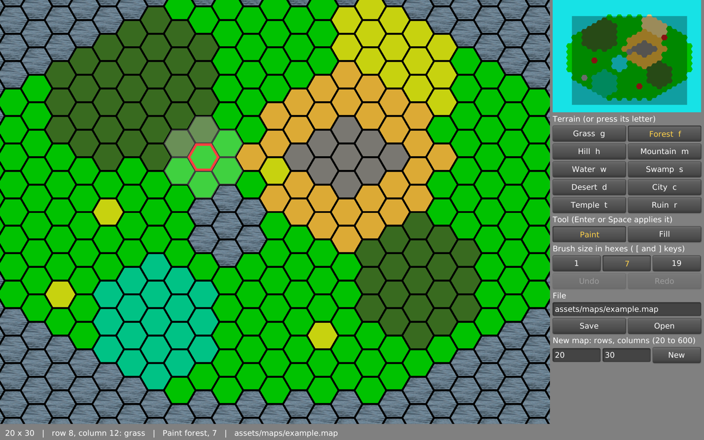

# Hexlords

A strategy game on a hex map, in the feel of the fantasy strategy games of
the 1990s. A few sides, each starting from one city, fight over a map of
cities until one of them is left. Cities bring in gold and build units; the
units go about in stacks of up to eight, led by captains who rise in level;
a stack sent into another side's units fights them, and takes the city if
that is where they stood. People play it (several at one screen, in turn)
and so does the computer, in a window or in a browser.


It is inspired by SSG's Warlords, to give credit where it is due: the map of
cities, the stacks of eight, the cheap troops against the dear ones. The
rules, the maps, the names and the pictures are its own: nothing is taken
from that game or any other.

It is written in Rust, on [Turbo Ferret](https://github.com/sstanfield/turbo-ferret)
for the UI and [miniquad](https://github.com/not-fl3/miniquad) for the
graphics, and on nothing else.

## Two ways to play

A game is played in one of two modes, chosen when it starts. Both run on the
same rules, and on any map.

**Turns** ("I go, you go"). The sides play one after the other. An order
happens as it is given: the stack moves, the battle is fought, and you see
what came of it before you give the next. When your turn comes again your
log says what the others did to you meanwhile. It is the careful, tactical game:
see, then decide.

**Rounds** ("we go"). Every side gives all its orders for the round before
anything moves, and none sees another's. A click is a plan, and the map
outlines the way the stack will take; a click after it adds a waypoint. When
every side has said its orders are done, the round plays out for all of them
at once, on a clock: a step takes a unit the share of the round that the
step's cost is of its movement, so the fast are there first. A stack fights
whoever it finds on its way, the first into a hex defends it against the
next, and stacks sent to join each other go on as one. It is the
game of guessing the other side: racing to reinforce a city, or to take one
before its relief arrives.



[docs/gameplay.md](docs/gameplay.md) has the rules in full, and why they are
as they are.

## What is in it

- **The game** (`cargo run`): a new game screen (the map, the mode, how
  battles go and how much chance is in them, the gold, fog of war, who plays
  each side), and then the game. Stacks move along the roads and fight;
  ships carry armies over the water and flyers go over anything; cities are
  taken, pay taxes, raise their walls and build what their holder queues up
  and can pay for; units rise in level and temples bless them. Orders can
  last: a stack sent far goes there over the turns, goes round on patrol, defends
  where it stands or is left to the computer to raid with, and a city sends
  what it builds to a rally point. The other sides show only as banners
  with their size, and fog of war is a choice (in part, or total: land never
  seen is black until it is explored); a city out of sight is as you saw it
  last. A list says what is left to do this
  turn, one window shows the whole side's production (what every city
  builds and where it goes, what the next rounds bring, whether the gold
  will keep paying the upkeep, and the stacks to cut it with), a log keeps your battles, which can be watched again, and what happened
  since your last turn can be replayed. A game that is not over is kept as
  it goes and played on later ([docs/saves.md](docs/saves.md)).
- **Computer players** ([docs/agents.md](docs/agents.md)): several styles
  that play either mode, a way to play them against each other with no
  window (`--headless`), and a text protocol for a program of your own to
  play a side.
- **Maps** in a plain text [format](docs/map-format.md), of any size and
  shape from 20 x 20 to 600 x 600: terrain, roads with bridges and mountain
  passes, the map's own kinds of unit, its cities with what they build and
  who stands in them, and pictures of its own if it wants them. The game
  comes with one to play on, a continent of nine cities for four sides, and
  a small example of a terrain file.
- **A [map editor](#the-map-editor)** for the terrain and the roads.
- **A random map generator**, `mapgen` ([docs/mapgen.md](docs/mapgen.md)),
  which the new game screen uses for "A random map", with a ruler for any
  map.
- **[The pictures](#the-pictures)**: the tiles, the roads, the units' signs
  and the windows' skin are drawn by a program in the repository, so the art
  is original and can be made again.
- **[A browser build](#in-a-browser)**: the same game as WebAssembly.

## Build and run

```sh
cargo run                                   # the new game screen
cargo run -- --map assets/maps/continent    # a game on the continent at once, against the computer
```

Rust 1.86 or newer. The only dependencies are miniquad and Turbo Ferret (fetched
by Cargo from its repository).

- **macOS:** nothing else is needed.
- **Linux:** miniquad needs
  `sudo apt-get install libx11-dev libxi-dev libgl1-mesa-dev libasound2-dev`.
- **Windows:** should build and run the same way; nobody has tried it by hand.

The game uses OpenGL (miniquad's default backend on every desktop platform).

### In a browser

The game also builds as WebAssembly and plays in a browser, the same game
with the same screens:

```sh
rustup target add wasm32-unknown-unknown    # once
cargo run -p web -- --serve                 # build it, then open http://127.0.0.1:8080
cargo run -p web                            # only build it, into target/web
```

`target/web` is all a web server has to give out: `index.html`,
`hexlords.wasm` (the game with its assets inside it, about 5 MB, half that
compressed), `gl.js` (miniquad's loader) and the licences. Put the directory
on any server of static files; a browser will not load WebAssembly from a
`file:` address, which is what `--serve` is for. `--out <dir>` fills another
directory, `--debug` makes an unoptimized build.

What is different in a browser:

- The maps are the ones in `assets/maps` when it was built, and random maps.
  There is no command line, so no `--map` and no agents of your own (`cmd:`).
- Nothing is kept, a game in progress neither (a page has no files): loading
  the page again is a new game.
- Fullscreen and closing are the browser's (F11; on a Mac Ctrl+Cmd+F), and it
  keeps some keys for itself: Ctrl+T and Ctrl+N do not reach the game (use
  the End turn button and the Game menu), and Cmd is not Ctrl there (undo is
  Ctrl+Z on a Mac too). The help (F1 or `?`) says so in a browser.
- It needs WebGL, which every current browser has.

## Controls

Along the top are the menus (Game, Units, Cities, View, Help: each item says
its keys) and, at the right end, your treasury: your gold, what your cities
bring in each turn (+), what your units cost (-). Under the map are the
selected hex's units, a box each: the leader's (its commander) on the left,
then one for each of the eight units a hex holds, and beside them Go to, Done
and Next. Beside the map, under the minimap, are End turn, Undo and Replay,
and the selected hex's city: one of yours in full (set what it builds, where
its new units go), another's as it shows from outside.

The help in the game (F1 or `?`) says every key, and the Help menu has the
rules of the game in play, and About Hexlords: the version, and the commit
it was built from. The most used:

| Input | What it does |
|---|---|
| A menu's title | Opens it (with one open, pointing at another title opens that one); a click elsewhere, or Esc, closes it |
| Move the pointer over the map | The hex under it becomes the cursor (red border) |
| Click a hex, or Enter at the cursor | With no unit selected: select your stack on the hex (those of its units that wait for orders), which shows where all of them can go. With units selected: they go to the hex together if all of them can reach it (into another side's units: an attack; the line under the map says the odds first), and stay selected while they can go on. A hex beyond their reach sends them there over the turns (Go to). Another of your stacks is selected instead, or, if the selected units can reach it, the game asks: join it, or select it. A stack that has orders (defends, marches, patrols) asks before it takes new ones, and says how many of the selected units the orders are ("1 of these 3 units is defending Redhold"). An order the rules refuse opens a window that says why |
| Drag on the map with the left button | Moves the map with the pointer (a press that hardly moves is still a click) |
| Esc | Close the menu or the window on top (the help first); with none open, drop the selection |
| Undo, or Ctrl+Z (Cmd+Z) | Take back the last move, what a city was set to build, or its walls: the units are back where they were, with their points, selected. Not a battle (chance had a say), nor a move that put a side out or, with fog of war, showed something new. In rounds: the last plan, or its last leg |
| Next, or N (Shift+N: back) | Select the nearest of your stacks that waits for orders, and look at it |
| Done, or D | Put the selected units aside for this turn: Next passes them by |
| F | The selected units defend where they stand, turn after turn, until they are sent somewhere (F again: no longer) |
| Go to, or G, then a hex | The selected units go there over as many turns as it takes: this turn's part now, the rest at the end of each of your turns. Shift+click (or Shift+Enter) on the way makes a stop they go by. In turns a march never attacks: if something is in the way it stops, says so in your log, and waits for orders (left alone, it tries again next turn) |
| P | Patrol: Shift+click the waypoints, click the last (the stack's own hex: round and round; else back and forth), then say whether it attacks what it sees, and at what odds |
| U | Maraud: the computer leads the stack, strikes what it can beat and takes the cities it can; U again calls it back |
| R | Rally points: ten flags of yours on the map, where cities send what they build and stacks are sent to gather |
| B | On a temple: the selected units seek its blessing (each temple blesses a unit once) |
| X | Disband the selected units, for good (it asks first) |
| C (Shift+C: back) | Look at your next city (and drop the selection) |
| H | Look at your capital (in hotseat, each person's turn starts there) |
| O, or Open the city's window (City details, for another's) | The selected hex's city in a window, with more room. Your own: a button for each thing it can build (pointing at one shows all about it), a queue (+ beside a kind: kinds in turn, how many of each, where they go, and whether it then stops or starts over), where its new units go (Send to..., then a hex; a rally point; Keep here; Defend here), and Raise the walls. The sidebar has the same in less room (Send..., Keep, Defend) |
| M, A | A list of your cities, or of all of them, with a minimap that rings the one you choose; open it in full, or go to it |
| E, or Cities > Production... | Your production in one window. A minimap with your cities and rally points (cities idle or waiting ringed in orange, the chosen one in gold with a line to where its units go); your gold, what comes in and goes out a turn, and whether the gold will go on paying the upkeep (if not, from which round); every city with what it builds and where its units go, the idle and waiting first; what the next 5 rounds finish; and, when shown, your stacks, the dearest first. A city's row chooses it: Open its window (what it builds, its queue), Stop, Keep, Defend, a rally point, or To a city... and then that city's row. A stack's row: Select puts it under the map (to send some of it home with X), Disband... all of it. Stop all production... stops every city, after asking |
| Tasks, or T | What you have left to do this turn, most pressing first: stacks with no orders and cities that build nothing; then cities whose work waits for gold or for room; then the rest. Click a row to see to it |
| Log, or L | Your log: every battle you fought, attacking or attacked, with who won and who died on each side (Watch plays it again); the cities you took and lost; who is out. The latest round first |
| Replay, or W | What happened since your last turn, again (in rounds: the round that played out). W again stops it; the slider beside the button goes back to any moment of it, where the map can be looked over but no orders given; Esc, or the turn's button, comes back to now |
| The End turn button, or Ctrl+T (Cmd+T) | The side's turn is over ("End turn (3)": three stacks or cities still wait for orders, and it asks first). The others play theirs, and the button says whose turn it waits for |
| Start turn (the same button, when your turn has come), or Ctrl+T | When your turn comes with news for you, your log opens first: this closes it and you play. With no news your turn starts at once |
| Point at a unit under the map | A box over it says all about the unit: its side, numbers, and what each terrain costs it to enter |
| Click a unit under the map | Take that unit into the selection, or leave it out: the reach of those selected shows on the map, and the line under the units is about them |
| Two fingers on a trackpad, or the mouse wheel, over the map | The map moves with the fingers (a wheel moves it up and down, and sideways with Shift) |
| Drag with the right or the middle button | Pulls the map along with the pointer |
| Ctrl (or Cmd) and the wheel or two fingers | Zoom in and out; what is under the pointer stays under it |
| Click or drag on the minimap | The main map goes to that part of the map (and the cursor with it) |
| Two fingers or the wheel over the minimap | The view goes the same way as over the main map, but much farther: a pixel of the minimap for a pixel of the fingers |
| Arrow keys | Move the cursor; the view follows when the cursor leaves it, and comes back to it if it was moved away |
| `1` / `2` | Zoom out / in, centered on the cursor |
| F1, or `?` | The help: every key and what the mouse does (Esc closes it). The Help menu also has the rules of the game in play: battles (the system and chance it was set up with), movement (what each of the map's kinds of unit pays), cities and gold, units and captains, orders and turns, what you see |
| Ctrl+, (Cmd+,) | Options: what the screen does for you as a turn goes (selects the next stack, asks before a turn ends, plays battles out or tells them in a line, shows moves as they happen). They are yours, not rules |
| Ctrl+Cmd+F, or F11 | Fullscreen on and off (macOS keeps F11 for itself) |
| Ctrl+N (or Cmd+N), or Game > New game... | Back to the new game screen: at once if the game is over, else after asking (a game that is not over is kept, and can be played on from there) |
| Ctrl+Q (or Cmd+Q) | Quit |

**In rounds** the same clicks make plans. A click on where a stack goes
outlines its way on the map, and nothing moves; while the stack has moves
left where the plan ends, another click is a waypoint it goes on to (a click
on the stack itself starts afresh). V outlines every stack's orders, or the
selected stack's only. The End turn button is Orders done: once every side
has pressed it the round plays out before you, a stack fighting whoever it
finds on its way, and your battles are played out in their window as the
round comes to them.

Your own stack is a disc in your side's color with the sign of its kind (its
commander's, if it has one); another side's is a banner in its color with
its size. A city shows itself, not the units in it: its roofs and walls in
its holder's color (grey for nobody's), and a pip for each unit of its
garrison. On the minimap a city is a square in its holder's color. The map
stops at its edges: the view never shows what is past them.

**Under the map** the first line says the turn and what is under the cursor
(with what it would cost the selected unit to go there, or, if it is another
side's units, how likely an attack on them is to be won). Below it is the
selected hex, the one last clicked: its terrain and road, and its units in
the stack's order, nine places in a row (a commander and eight units), each
the unit's icon with its strength and the movement points it has left
(`4 · 6/10`). Pointing at one opens a box with all about it; clicking it
takes it into the selection or out of it (the selected are outlined), and
the last line is about the selected units. The map takes all the room the
panel leaves. **Under the minimap** is the selected hex's city: its name,
its walls and taxes, its garrison, what it is building and what it can
build.





**A new game** starts on its own screen: the map (one of the game's, or a
random map made there; the preview beside the settings can be looked over
like the game's), how to play (turns or rounds, above), the order of the
turns (the same each round, or drawn anew; in rounds always drawn, since it
says who goes first of two there at the same moment, and the choice is
greyed out), the battles (lines, or strength against strength; how much
chance, from 0 to 10; whether wounds last and whether the loser of an exchange may hit back;
a cap of 9 on a unit's strength), the gold each side starts with, fog of war
(off, on, or total), and who plays each side, a person or the computer (a
click on Computer again goes through its styles). Several people take turns
at one screen (hotseat): between two people's turns a screen hides the map
until the next one says they are there.


Under the list of maps a line says how big the map shown is and how many
cities it has (a random map: once it is made).

**Games in progress.** A game that is not over is kept by itself, in a file:
when it starts, each time a turn passes, when it is left for a new game and
when the window closes, in the middle of a turn or of a round if that is
where it was. The new game screen lists those games first, the last played
first: Play on goes on with one as it was left, Delete (pressed twice)
takes it away. A game that is over is kept no more. The files are where the
system keeps a program's data (macOS: `~/Library/Application
Support/Hexlords/saves`; Linux: `~/.local/share/hexlords/saves`; Windows:
`%APPDATA%\Hexlords\saves`), or where `--saves` says. A saved game is the
map, the setup and every order given since, which make the same game again
([docs/saves.md](docs/saves.md)): one saved by another version of the rules
may no longer come out the same, and then says so and is not played on.

**The rules in short** (in turns; [docs/gameplay.md](docs/gameplay.md) has
them in full, and the Help menu those of the game in play). On a side's turn
only its units move and only its cities can be set to build; End turn passes
to the next side, and the computer plays its sides' turns. A side's turn
begins with its units' points back and its cities' work. A city of another
side, or nobody's, with nobody in it, is taken by moving into it. Units sent
into another side's units attack them, as many as a hex holds (from one hex
or several): the two stacks fight until one is gone, and if the attackers
win they go in (and take the city, if it is one). Strength counts, and so do
chance, the ground (a defender is 1 stronger on hills and in forests, 2 on
mountains), a city's walls (1 behind walls 1 or 2, 2 behind 3 to 5, 3 behind
6) and a commander, who makes every other unit of its stack 1 stronger (or
as much as its kind says). A side that loses its last city is out, and the
last side left wins; when the last person is out, the computer plays on to
the end.

A battle is played out in a window: both stacks, a card for each unit with
what it fights with and where its bonuses come from, and then the exchanges,
a few a second, the two that fight lit, the one hit in red with an X, the
dead dimmed (Skip, Watch again). A battle the others fight against you is
shown as it happens, and the game waits until you close its window. In any
battle's window Enter ends the battle and then closes it, as Close and Esc
do. Every battle you fought, attacking or attacked, can be
watched again from your log for a few rounds (its Watch button).

Units rise in level from the battles they win: veteran (a silver ring), then
elite (gold), each a point stronger; some cities train their units, which
come out veterans or elite. A temple blesses the units of a stack that seeks
its blessing there (B), each unit once: +1 strength or +2 moves. Captains
have names and levels too, and a stack with no captain that wins a hard
fight may see one rise from its ranks.

Each side has a treasury (the menu bar shows yours: "34 +40 -32"). At the
start of each of its turns its cities' taxes come in and its units' upkeep
goes out; units it cannot pay leave it. What a city finishes is paid for
then, at the city's price; without the gold, the unit waits in the city
until there is enough. A full city keeps what stays in it waiting for room,
but lets out what it sends elsewhere: onto the best hex beside the city on
its way that is free (room for it, no other side's units), if there is
one. A city's holder can raise its walls a level a turn,
for gold; a city that is taken loses a level.




## Options

```
hexlords [--map <file.map or map directory>] [--players <side>=<who>,...] [--mode turns|rounds]
        [--order fixed|drawn] [--seed <n>]
        [--chance <0-10>] [--battles lines|strength] [--wounds] [--blows-back]
        [--cap <n>] [--gold <n>] [--fog | --total-fog] [--headless [--rounds <n>] [--log]]
        [--saves <dir>] [--script <steps>]
        [--assets <dir>] [--frames <n>] [--screenshot <file.png>]
hexlords --version
```

`--version` says which version this is and what it was built from (the
branch and the commit, `+` if the sources had changes not committed; the
profile, the target, when, the compiler), as About Hexlords does. The
version goes `0.<rules>.<patch>`: the middle number moves when the rules
change, and games saved before may not load; the last for any other change.

Without `--map` the window opens on the new game screen, which sets the
game up; the options that set up a game (`--players` to `--total-fog`) go
with `--map`, and without it are not used.

- `--map <file.map or map directory>`: play this map at once (the format is
  in `docs/map-format.md`): one person plays the side of the first city with
  a garrison, where the view starts, and the computer the others.
- `--players red=person,blue=bold`: who plays which side: `person`, or an
  agent of the computer's: `steady` (the default), `bold`, `careful` (the planner's styles), `simple`, `passive`, `cmd:<program>`
  ([docs/agents.md](docs/agents.md), which has more: `steady/turns`, a
  planner that plays rounds as it plays turns, to measure against).
- `--mode turns|rounds`: the sides play one after the other (turns, unless
  it is said), or all give their orders and the round plays out at once
  ([docs/gameplay.md](docs/gameplay.md), "Rounds").
- `--order fixed|drawn`: the sides play in the same order each round, or one
  drawn anew (in rounds it is always drawn, whatever this says); `--seed <n>`: the seed of the game's chance (without it: one
  from the clock in a window, each game its own; 1 without a window, or
  with a script or a screenshot, so that a run can be made again).
- `--chance <0-10>`: how much chance there is in a battle: 0 none (the
  stronger always wins), 10 nothing else; 5 unless it is said.
  `--battles lines|strength`: how a battle goes (lines unless it is said;
  [docs/gameplay.md](docs/gameplay.md), "Fighting"). `--wounds`: a unit's
  hits stay with it until its side's turn ends, and it fights at half
  strength while wounded. `--blows-back`: the loser of an exchange may hit
  back, a quarter of the time at most. `--cap <n>`: no unit fights stronger
  than `n`, all its bonuses counted. `--gold <n>`: the gold
  each side starts with (50). `--fog`: fog of war: each side sees only what
  is near its units and cities. `--total-fog`: that, and the land a side has
  never seen is black, and shut to its units, until it has seen it.
- `--headless`: no window: the computer plays every side of `--map` until one
  side is left or `--rounds` (200) have gone by, and says how it went
  (`--log`: and all that happened). [docs/agents.md](docs/agents.md) says
  more, and how a program of one's own plays a side.
- `--saves <dir>`: keep the games in progress in this directory. Without it:
  where the system keeps a program's data (above); a run with `--script`,
  `--screenshot` or `--frames` keeps nothing unless it is told where.
- `--assets <dir>`: where the assets are. Without it: `../assets` next to the
  executable if that exists, else `assets` in the source tree (so `cargo run`
  works).
- `--frames <n>`: draw `n` frames and quit (a smoke test).
- `--screenshot <file.png>`: draw a frame into a PNG file and quit (the last
  frame of `--frames`, or the second). The exit status is 1 if the file could
  not be written.
- `--script <steps>`: play some input before the first frame. Steps are
  separated by commas: `left`, `right`, `up`, `down`, `enter`, `esc`, `space`,
  `1`, `2`, `key:X` (any character; `key:ctrl+s` with modifiers),
  `click:ROW:COL`, `shiftclick:ROW:COL` (a click with Shift held),
  `hover:ROW:COL`, `drag:ROW:COL:ROW:COL`, `minimap:ROW:COL`
  (click the minimap there), `press:ID` (click the widget with that id),
  `point:ID` (point at it),
  `scroll:DX:DY` (two fingers on the map: it moves that many pixels right and
  down), `miniscroll:DX:DY` (the same on the minimap), `zoomin:ROW:COL` and
  `zoomout:ROW:COL` (Ctrl and the wheel over that hex), `pull:DX:DY` (a drag
  with the right button), `cursor:ROW:COL` (jump there), `turn` (in a game,
  a round: the turn ends, the others play, the next starts), `wait:MS` (MS
  milliseconds of frames go by, on the script's own clock: the computer's
  turns, a battle being watched), and `*N` repeats a step.

```sh
cargo run -- --map assets/maps/continent --screenshot shot.png --script "enter,1"   # a unit's range, zoomed out
cargo run -- --map assets/maps/continent --players green=person    # two people, red and green
cargo run --release -- --headless --map assets/maps/continent --seed 7   # the computer against itself
```

## The map editor

```sh
cargo run -p mapeditor -- assets/maps/mine.map      # edit it, or start it if it is not there
cargo run -p mapeditor -- assets/maps/continent     # a map directory: its terrain and roads
cargo run -p mapeditor -- mine.map --new 60x90      # a new map of 60 rows and 90 columns
cargo run -p mapeditor -- --check assets/maps/*     # what is in these maps, and what is wrong with them
```



The main map and the minimap work as in the game (the pointer, the arrows, `1`
and `2`, two fingers or the wheel, a drag with the right button, a click or a
drag on the minimap). The sidebar chooses what a press on
the map does:

| Input | What it does |
|---|---|
| A terrain button | Choose the terrain to paint with |
| The terrain's letter (`g f h m w s d c t r`) | Choose it and paint at the cursor, which follows the pointer: point and type |
| Press or drag on the map | Paint (a drag leaves no gaps), or fill with the Fill tool |
| Paint / Fill | Paint puts the terrain under the brush; Fill gives it to the hex and every hex of the same terrain connected to it |
| Road / No road | A press lays a road on the hex (over water: a bridge), a drag lays it along the way; No road takes it away. The terrain stays, and new terrain painted under a road leaves the road |
| 1 / 7 / 19, or `[` and `]` | The brush's size in hexes. The larger ones show what they would paint |
| Enter or Space | Use the tool at the cursor |
| Undo / Redo, Ctrl+Z / Ctrl+Shift+Z or Ctrl+Y (Cmd on macOS) | A drag, a fill or a key is one step; 200 steps are kept |
| The File field, Save, Open, Ctrl+S | Save writes the map to the file named in the field, Open reads it. Enter or Esc in a field gives the keys back to the map |
| The two numbers and New | A new map of that many rows and columns, all of the chosen terrain |

Open, New and quitting ask a second time when the map has unsaved changes. The
status line at the bottom shows the map's size, the hex under the cursor, the
tool, the file, and what the last action had to say.

The editor edits the terrain and the roads. Of a map directory that is its
`terrain.map`; the units and the cities are text files, edited as text, and
when the editor saves it says what `cities.txt` has to say about the new
terrain (a city that is no longer on a city tile, a city tile without an
entry). `--check` reads a whole map as the game does and reports on all of it.

It takes the game's `--assets`, `--frames`, `--screenshot` and `--script`
(`--script "press:terrain_w,press:brush_7,click:10:12,key:ctrl+s"`).

## The pictures

```sh
cargo run -p assetgen --release                                # draw the game's pictures again
cargo run -p assetgen --release -- --previews target/previews  # and maps drawn with them, to look at
```

The map's pictures are not drawn by hand: `tools/assetgen` (Rust, no
dependencies) computes them from noise and shapes. The ten terrain tiles in
`assets/tiles`, each running on into its neighbours of the same terrain
without a seam, and a city for each side; a road and a bridge in each of the
14 shapes a hex's road can have, in `assets/roads`; a sign for each of the
game's kinds of unit in `assets/units`; and the windows' and buttons'
pictures in `assets/skin`. So the
art is original, it is under the game's licence and no other, and it can be
made again at any size. [docs/tiles.md](docs/tiles.md) says how each picture
lies in its file and how to change the art. A map can bring pictures of its
own, which are used instead of these.


## Development

```sh
cargo fmt --all --check
cargo clippy --workspace --all-targets -- -D warnings
cargo test --workspace    # needs no GPU and no display
```

The repository is a Cargo workspace: the game at its root, the tools
(`mapeditor`, `assetgen`, `mapgen`, `web`) under `tools/`. The code is laid out so that
almost all of it runs in `cargo test`:
the game state (`src/state`, `src/game.rs`), the view math (`src/view.rs`,
`src/minimap_view.rs`), the geometry the renderers draw (`src/render`), and the
UI with its input (`src/screen.rs`, `src/session.rs` and the editor, driven
headlessly by `tests/` and `tools/mapeditor/tests/`). Only the GPU calls need a
window, and the screenshot mode shows what they draw. `CLAUDE.md`
has the layout and the rules of the repository.

Hexlords began as a Rust port of an older C++ demo of the author's
([hexGame](https://github.com/sstanfield/hexGame)) and has gone its own way
since. `docs/deviations.md` is what is left of that: history, not a
specification.

### What has been run where

Everything was built, tested and looked at (through screenshots, and a window
resize) on **macOS 15, Apple Silicon, at 2x**, and the owner has run the game's
live window there. The map editor has only been driven by tests and scripted
screenshots: nobody has used its live window yet. **Linux and Windows have not been
run**: CI
(`.github/workflows/ci.yml`) builds and tests on all three, and has itself not
run yet. Things to try by hand on each: the mouse (hover, click to select and
move), the keys above, resizing the window, a HiDPI and a plain screen, F11
and F1.

The browser build was run in **Chrome 157 on macOS** (headless, driven over
its DevTools protocol, at 1x and 2x): the new game screen, a random map, turns
and a round against the computer, the mouse, the wheel, a right drag, the keys
and the menus. **Firefox and Safari have not been tried**, nor a touch screen,
and nobody has played it there by hand yet.

## Licences

Hexlords is under the zlib licence (`LICENSE`), as the C++ original is.

`NOTICE` lists what it is built on and ships with: Turbo Ferret and Turbo Badger
(zlib), Turbo Badger's default skin in `assets/skin` (public domain), miniquad
(MIT or Apache-2.0), and the built-in font, DejaVu Sans, whose licence notice
has to accompany every copy of the program. The tiles, the roads, the units' signs and the
windows' pictures are made by `tools/assetgen` and are part of the game; one
unit picture, `assets/units/default_unit.png`, is the C++ demo's.
