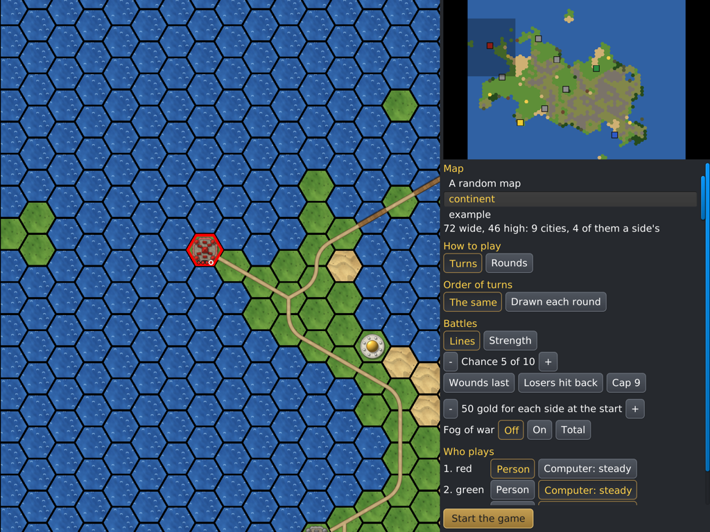
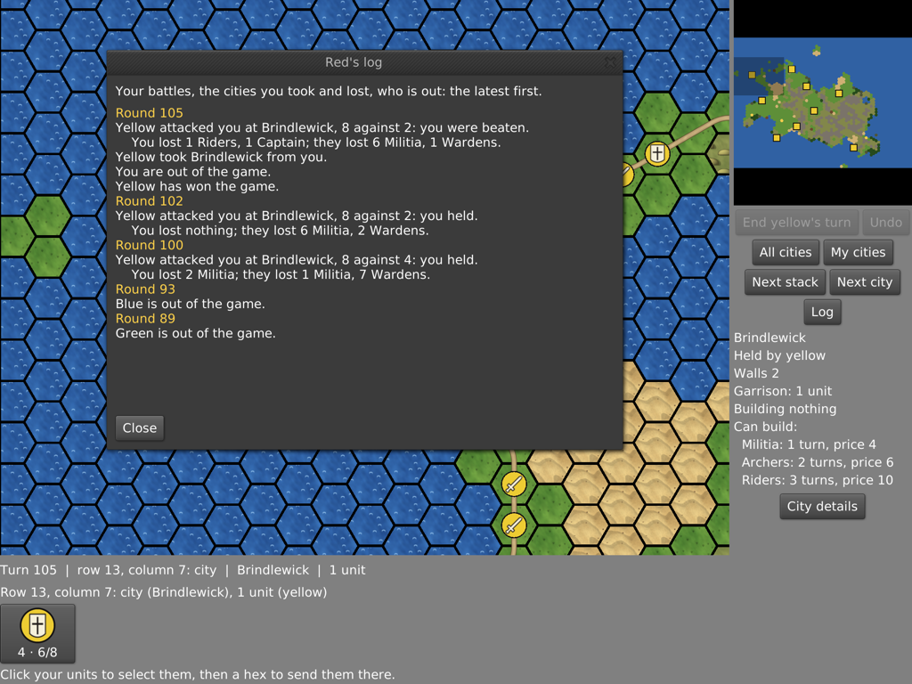

# Hexlords

A hex map strategy game in Rust, of cities, stacks of units and sides that
take turns. It began as a port of the C++
[hexGame](https://github.com/sstanfield/hexGame) engine demo, and goes its own
way. The UI is [Turbo Ferret](https://github.com/sstanfield/turbo-ferret) and
the graphics go through [miniquad](https://github.com/not-fl3/miniquad).


The port is done (`docs/deviations.md` records how it differs from the C++),
and from here the game goes its own way. `hexgame-rust-port-plan.md` has the
direction. So far:

- a [map format](docs/map-format.md) in plain text, for maps of any size and
  shape from 20 x 20 to 600 x 600: terrain, roads with bridges and mountain
  passes, the map's own kinds of unit, its cities with what they build and
  who stands in them, and pictures of its own if it wants them;
- the game plays such a map (`--map`, or the new game screen): sides take
  turns, people (hotseat) and the computer; stacks move along the roads and
  fight, led by captains who rise in level; ships carry armies over the
  water, and flyers go over anything; cities are taken, pay taxes and
  build what their holder sets and can pay for; stacks can be sent far over
  turns, cities can send what they build, and a list says what is left to
  do; the other sides show only as banners, and fog of war is a choice (in
  part, or total: land never seen is black until it is explored); the
  last side left wins. [docs/gameplay.md](docs/gameplay.md) is the plan for
  the rules, in two modes (sides taking turns, built; or all giving orders
  at once);
- a [map editor](#the-map-editor) for the terrain and the roads;
- a random map generator, `mapgen`, with a ruler for any map
  ([docs/mapgen.md](docs/mapgen.md)): the terrain so far; rivers, cities,
  sites and roads to come;
- [tiles, roads and unit signs](#the-pictures) drawn by a program in the
  repository, so the art is original and can be made again.

## Build and run

```sh
cargo run                                   # the new game screen
cargo run -- --map assets/maps/continent    # a game on the continent at once, against the computer
```

Rust 1.86 or newer. The only dependencies are miniquad and Turbo Ferret (fetched
by Cargo from its repository).

- **macOS:** nothing else is needed.
- **Linux:** miniquad needs
  `sudo apt-get install libx11-dev libxi-dev libgl1-mesa-dev libasound2-dev`.
- **Windows:** should build and run the same way; nobody has tried it by hand.

The game uses OpenGL (miniquad's default backend on every desktop platform).

## Controls

Along the top are the menus (Game, Units, Cities, View, Help: each item says
its keys) and, at the right end, your treasury: your gold, what your cities
bring in each turn (+), what your units cost (-). Under the map are the
selected hex's units, a box each: the leader's (its commander) on the left,
then one for each of the eight units a hex holds, and beside them Go to, Done
and Next. Beside the map are End turn and Undo, and the selected hex's city:
one of yours in full (set what it builds, where its new units go), another's
as it shows from outside.

| Input | What it does |
|---|---|
| A menu's title | Opens it (with one open, pointing at another title opens that one); a click elsewhere, or Esc, closes it |
| Move the pointer over the map | The hex under it becomes the cursor (red border) |
| Click a hex, or Enter at the cursor | The hex is the selected one: the panels are about it. With no unit selected: select your stack on the hex (those of its units with moves left), which shows where all of them can go (red tint). With units selected: they move to the hex together if all of them can reach it (into another side's units: an attack); any other hex drops the selection (and selects your stack there, if it has one) |
| Drag on the map with the left button | Moves the map with the pointer (a press that hardly moves is still a click) |
| Esc | Close the menu or the window on top (the help first); with none open, drop the selection |
| Undo, or Ctrl+Z (Cmd+Z) | Take back the last move or city order, unless it was a battle (chance had a say) or put a side out: the units are back where they were, with their points, selected |
| Next, or N (Shift+N: back) | Select the next of your stacks that can still move, and look at it |
| C (Shift+C: back) | Look at your next city (and drop the selection) |
| H | Look at your capital (in hotseat, each person's turn starts there) |
| Go to, or G, then a hex | The selected units go there over as many turns as it takes: this turn's part now, the rest at the start of your next turns. A march never attacks: if something is in the way it stops, says so in your log, and waits for orders (left alone, it tries again next turn). Esc: never mind |
| Done, or D | Put the selected units aside for this turn: Next stack passes them by, and the next stack that waits is selected |
| Tasks, or T | What you have left to do this turn, most pressing first: stacks with no orders and cities that build nothing; then stacks that can go further and cities whose work waits; then the rest. Click a row to see to it |
| Send to..., beside the map or in a city's window, then a hex | What the city builds goes there on its own (Keep here: it stays) |
| Log, or L | Your log: every battle you fought, attacking or attacked, with who won and who died on each side; the cities you took and lost; who is out. The latest round first |
| Point at a unit under the map | A box over it says all about the unit: its side, numbers, and what each terrain costs it to enter |
| Point at what your city can build, beside the map | A box beside it says all about it: turns, price, upkeep, what each terrain costs it |
| Click a unit under the map | Take that unit into the selection, or leave it out (a unit of another hex starts a new one): the reach of those selected shows on the map, and the line under the units is about them |
| Two fingers on a trackpad, or the mouse wheel, over the map | The map moves with the fingers (a wheel moves it up and down, and sideways with Shift) |
| Drag with the right or the middle button | Pulls the map along with the pointer |
| Ctrl (or Cmd) and the wheel or two fingers | Zoom in and out; what is under the pointer stays under it |
| Click or drag on the minimap | The main map goes to that part of the map (and the cursor with it) |
| Two fingers or the wheel over the minimap | The view goes the same way as over the main map, but much farther: a pixel of the minimap for a pixel of the fingers |
| Arrow keys | Move the cursor; the view follows when the cursor leaves it, and comes back to it if it was moved away |
| `1` / `2` | Zoom out / in, centered on the cursor |
| The End turn button ("End red's turn"), or Ctrl+T (Cmd+T) | The side's turn is over: your log opens, and shows what the others do while they play their turns (the computer's a little apart; the button says whose turn it waits for); a turn begins with the side's units' points back and its cities' work |
| Start turn (the same button, when your turn has come), or Ctrl+T | Close the log and play (an order on the map starts the turn too) |
| O, or Open the city's window (City details, for another's) | The selected hex's city in a window, with more room: all about it, and a button for each thing it can build, with the unit's icon, strength and moves (only its holder's to press); pointing at one shows all about it |
| M, A | A list of your cities, or of all of them, with a minimap that rings the one you choose; open it in full, or go to it |
| F1, or `?` | The help: every key and what the mouse does (Esc closes it). The Help menu also has the rules of the game in play: battles (the system and chance it was set up with), movement (what each of the map's kinds of unit pays), cities and gold, units and captains, orders and turns, what you see |
| Ctrl+Cmd+F, or F11 | Fullscreen on and off (macOS keeps F11 for itself) |
| Ctrl+N (or Cmd+N), or Game > New game... | Back to the new game screen: at once if the game is over, else after asking (the game is not saved) |
| Ctrl+Q (or Cmd+Q) | Quit |

A unit is a disc in its side's color with the sign of its kind. A city shows
itself, not the units in it: its roofs and walls in its holder's color (grey
for nobody's), and a pip for each unit of its garrison in that unit's color
(the selected unit's ringed in gold). On the minimap a city is a square in
its holder's color. The map stops at its edges: the view never shows what is
past them.

**Under the map** the first line says the turn and what is under the cursor
(with what it would cost the selected unit to go there, or, if it is another
side's units, how likely an attack on them is to be won). Below it is the
selected hex, the one last clicked: its terrain and road, and its units in
the stack's order, nine places in a row (eight units and a commander), each
the unit's icon with its strength and the movement points it has left
(`4 · 6/10`). Pointing at one opens a box with all about it; clicking it
takes it into the selection or out of it (the selected are pressed in, their
numbers in gold), and the last line is about the selected units. The map takes all
the room the panel leaves. **Under the minimap** are your
gold, taxes and upkeep, and the selected hex's city: its name, who holds it,
its walls and taxes, its garrison, what it is building and what it can
build, in how many turns, at what price.


**A new game** starts on its own screen: the map (the preview beside the
settings can be looked over like the game's), how to play (turns; rounds are
to come), the order of the turns (the same each round, or drawn anew), the
battles (lines or strength, and how much chance, from 0 to 10), the gold
each side starts with, and who plays each side, a person or the computer. Several people take turns at
one screen (hotseat): between two people's turns a screen hides the map
until the next one says they are there.



The sides play one after the other. On a side's turn only its units move and
only its cities can be set to build ("my cities"); End turn passes to the
next side, and the computer plays its sides' turns at once. A side's turn
begins with its units' points back and its cities' work. A city of another
side, or nobody's, with nobody in it, is taken by moving into it. Units sent
into another side's units attack them, as many as a hex holds (from one hex
or several): the two stacks fight until one is gone, and if the attackers
win they go in (and take the city, if it is one).
Strength counts, and so do chance, the ground (hills and forests 1, mountains
2), a city's walls (¾ a level) and a commander, who makes every other unit of
its stack 1 stronger (or as much as its kind says). A battle is played out
in a window: both stacks, a card for each unit with what it fights with and
where its bonuses come from, and then the exchanges, a few a second, the two
that fight lit, the one hit in red with an X, the dead dimmed (Skip, Watch
again). Every battle you fought, attacking or attacked, can be watched again
from your log for a few rounds (its Watch button). While the others play,
your log is open and fills as they go; Start turn begins yours. When the
last person is out, the computer plays on, a turn at a time, to the end. A side that loses its last
city is out, and the last side left wins.

Units rise in level from the battles they win: veteran (a silver ring), then
elite (gold), each a point stronger; a city may train its units a level up.
A temple blesses a unit that stops on it, once: +1 strength or +2 moves.
Captains have names and levels too, and a stack with no captain that wins a
hard fight may see one rise from its ranks.

Each side has a treasury (the sidebar shows yours: "Gold 34", "Taxes +40,
upkeep -32"). At the start of each of its turns its cities' taxes come in
and its units' upkeep goes out; units it cannot pay leave it. What a city
finishes is paid for then, at the city's price; without the gold, the unit
waits in the city until there is enough ([docs/gameplay.md](docs/gameplay.md)).




## Options

```
hexlords [--map <file.map or map directory>] [--players <side>=<who>,...] [--order fixed|drawn] [--seed <n>]
        [--chance <0-10>] [--battles lines|strength] [--gold <n>] [--fog | --total-fog] [--headless [--rounds <n>] [--log]]
        [--script <steps>]
        [--assets <dir>] [--frames <n>] [--screenshot <file.png>]
```

Without `--map` the window opens on the new game screen.

- `--map <file.map or map directory>`: play this map at once (the format is
  in `docs/map-format.md`): one person plays the side of the first city with
  a garrison, where the view starts, and the computer the others.
- `--players red=person,blue=bold`: who plays which side: `person`, or an
  agent of the computer's: `steady` (the default), `bold`, `careful` (the
  planner's styles), `simple`, `passive`, `cmd:<program>`
  ([docs/agents.md](docs/agents.md)).
- `--order fixed|drawn`: the sides play in the same order each round, or one
  drawn anew; `--seed <n>`: the seed of the game's chance.
- `--chance <0-10>`: how much chance there is in a battle: 0 none (the
  stronger always wins), 10 nothing else; 5 unless it is said.
  `--battles lines|strength`: how a battle goes (lines unless it is said;
  [docs/gameplay.md](docs/gameplay.md), "Fighting"). `--gold <n>`: the gold
  each side starts with (50). `--fog`: fog of war: each side sees only what
  is near its units and cities. `--total-fog`: that, and the land a side has
  never seen is black, and shut to its units, until it has seen it.
- `--headless`: no window: the computer plays every side of `--map` until one
  side is left or `--rounds` (200) have gone by, and says how it went
  (`--log`: and all that happened). [docs/agents.md](docs/agents.md) says
  more, and how a program of one's own plays a side.
- `--assets <dir>`: where the assets are. Without it: `../assets` next to the
  executable if that exists, else `assets` in the source tree (so `cargo run`
  works).
- `--frames <n>`: draw `n` frames and quit (a smoke test).
- `--screenshot <file.png>`: draw a frame into a PNG file and quit (the last
  frame of `--frames`, or the second). The exit status is 1 if the file could
  not be written.
- `--script <steps>`: play some input before the first frame. Steps are
  separated by commas: `left`, `right`, `up`, `down`, `enter`, `esc`, `space`,
  `1`, `2`, `key:X` (any character; `key:ctrl+s` with modifiers),
  `click:ROW:COL`, `hover:ROW:COL`, `drag:ROW:COL:ROW:COL`, `minimap:ROW:COL`
  (click the minimap there), `press:ID` (click the widget with that id),
  `point:ID` (point at it),
  `scroll:DX:DY` (two fingers on the map: it moves that many pixels right and
  down), `miniscroll:DX:DY` (the same on the minimap), `zoomin:ROW:COL` and
  `zoomout:ROW:COL` (Ctrl and the wheel over that hex), `pull:DX:DY` (a drag
  with the right button), `cursor:ROW:COL` (jump there), `turn` (in a game,
  a round: the turn ends, the others play, the next starts), `wait:MS` (MS
  milliseconds of frames go by, on the script's own clock: the computer's
  turns, a battle being watched), and `*N` repeats a step.

```sh
cargo run -- --map assets/maps/continent --screenshot shot.png --script "enter,1"   # a unit's range, zoomed out
cargo run -- --map assets/maps/continent --players green=person    # two people, red and green
cargo run --release -- --headless --map assets/maps/continent --seed 7   # the computer against itself
```

## The map editor

```sh
cargo run -p mapeditor -- assets/maps/mine.map      # edit it, or start it if it is not there
cargo run -p mapeditor -- assets/maps/continent     # a map directory: its terrain and roads
cargo run -p mapeditor -- mine.map --new 60x90      # a new map of 60 rows and 90 columns
cargo run -p mapeditor -- --check assets/maps/*     # what is in these maps, and what is wrong with them
```


The main map and the minimap work as in the game (the pointer, the arrows, `1`
and `2`, two fingers or the wheel, a drag with the right button, a click or a
drag on the minimap). The sidebar chooses what a press on
the map does:

| Input | What it does |
|---|---|
| A terrain button | Choose the terrain to paint with |
| The terrain's letter (`g f h m w s d c t r`) | Choose it and paint at the cursor, which follows the pointer: point and type |
| Press or drag on the map | Paint (a drag leaves no gaps), or fill with the Fill tool |
| Paint / Fill | Paint puts the terrain under the brush; Fill gives it to the hex and every hex of the same terrain connected to it |
| Road / No road | A press lays a road on the hex (over water: a bridge), a drag lays it along the way; No road takes it away. The terrain stays, and new terrain painted under a road leaves the road |
| 1 / 7 / 19, or `[` and `]` | The brush's size in hexes. The larger ones show what they would paint |
| Enter or Space | Use the tool at the cursor |
| Undo / Redo, Ctrl+Z / Ctrl+Shift+Z or Ctrl+Y (Cmd on macOS) | A drag, a fill or a key is one step; 200 steps are kept |
| The File field, Save, Open, Ctrl+S | Save writes the map to the file named in the field, Open reads it. Enter or Esc in a field gives the keys back to the map |
| The two numbers and New | A new map of that many rows and columns, all of the chosen terrain |

Open, New and quitting ask a second time when the map has unsaved changes. The
status line at the bottom shows the map's size, the hex under the cursor, the
tool, the file, and what the last action had to say.

The editor edits the terrain and the roads. Of a map directory that is its
`terrain.map`; the units and the cities are text files, edited as text, and
when the editor saves it says what `cities.txt` has to say about the new
terrain (a city that is no longer on a city tile, a city tile without an
entry). `--check` reads a whole map as the game does and reports on all of it.

It takes the game's `--assets`, `--frames`, `--screenshot` and `--script`
(`--script "press:terrain_w,press:brush_7,click:10:12,key:ctrl+s"`).

## The pictures

```sh
cargo run -p assetgen --release                                # draw the game's pictures again
cargo run -p assetgen --release -- --previews target/previews  # and maps drawn with them, to look at
```

The map's pictures are not drawn by hand: `tools/assetgen` (Rust, no
dependencies) computes them from noise and shapes. The ten terrain tiles in
`assets/tiles`, each running on into its neighbours of the same terrain
without a seam; a road and a bridge in each of the 14 shapes a hex's road can
have, in `assets/roads`; and four signs for units in `assets/units`. So the
art is original, it is under the game's licence and no other, and it can be
made again at any size. [docs/tiles.md](docs/tiles.md) says how each picture
lies in its file and how to change the art. A map can bring pictures of its
own, which are used instead of these.


## Development

```sh
cargo fmt --all --check
cargo clippy --workspace --all-targets -- -D warnings
cargo test --workspace    # needs no GPU and no display
```

The repository is a Cargo workspace: the game at its root, the tools
(`mapeditor`, `assetgen`) under `tools/`. The code is laid out so that almost all of it runs in `cargo test`:
the game state (`src/state`, `src/game.rs`), the view math (`src/view.rs`,
`src/minimap_view.rs`), the geometry the renderers draw (`src/render`), and the
UI with its input (`src/screen.rs`, `src/session.rs` and the editor, driven
headlessly by `tests/` and `tools/mapeditor/tests/`). Only the GPU calls need a
window, and the screenshot mode shows what they draw. `CLAUDE.md`
has the layout and the rules of the repository.

The C++ original is not part of this repository. To read it next to the port:
`git clone https://github.com/sstanfield/hexGame reference/hexGame` (the
directory is gitignored).

### What has been run where

Everything was built, tested and looked at (through screenshots, and a window
resize) on **macOS 15, Apple Silicon, at 2x**, and the owner has run the game's
live window there. The map editor has only been driven by tests and scripted
screenshots: nobody has used its live window yet. **Linux and Windows have not been run**: CI
(`.github/workflows/ci.yml`) builds and tests on all three, and has itself not
run yet. Things to try by hand on each: the mouse (hover, click to select and
move), the keys above, resizing the window, a HiDPI and a plain screen, F11
and F1.

## Licences

Hexlords is under the zlib licence (`LICENSE`), as the C++ original is.

`NOTICE` lists what it is built on and ships with: Turbo Ferret and Turbo Badger
(zlib), Turbo Badger's default skin in `assets/skin` (public domain), miniquad
(MIT or Apache-2.0), and the built-in font, DejaVu Sans, whose licence notice
has to accompany every copy of the program. The terrain tiles are made by
`tools/assetgen` and are part of the game; the unit picture is the C++ demo's.
