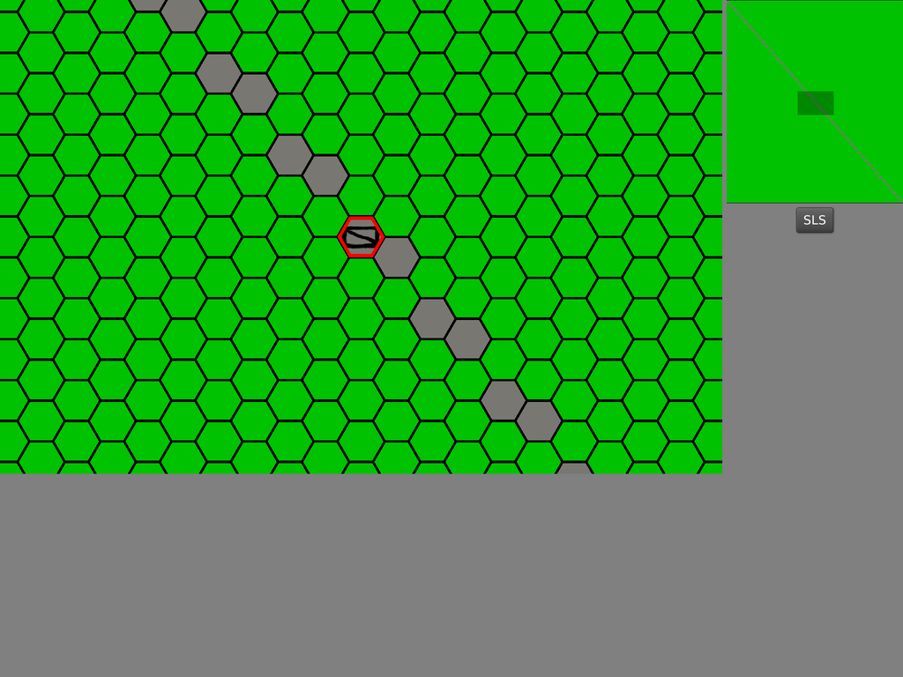

# HexGame

A hex map strategy game foundation in Rust. It is a port of the C++
[hexGame](https://github.com/sstanfield/hexGame) engine demo: a 100 x 100 map of
flat-topped hexes, one unit that can be selected and moved within its movement
range, zoom, and a minimap. The UI is
[Turbo Ferret](https://github.com/sstanfield/turbo-ferret) and the graphics go
through [miniquad](https://github.com/not-fl3/miniquad).



The port is done (`docs/deviations.md` records how it differs from the C++),
and from here the game goes its own way. `hexgame-rust-port-plan.md` has the
direction.

## Build and run

```sh
cargo run
```

Rust 1.86 or newer. The only dependencies are miniquad and Turbo Ferret (fetched
by Cargo from its repository).

- **macOS:** nothing else is needed.
- **Linux:** miniquad needs
  `sudo apt-get install libx11-dev libxi-dev libgl1-mesa-dev libasound2-dev`.
- **Windows:** should build and run the same way; nobody has tried it by hand.

The game uses OpenGL (miniquad's default backend on every desktop platform).

## Controls

| Input | What it does |
|---|---|
| Move the pointer over the map | The hex under it becomes the cursor (red border) |
| Click a hex, or Enter at the cursor | With nothing selected: select the unit on the hex, which shows where it can go (red tint). With a unit selected: move it to the hex if it can reach it, or deselect it if this is its own hex |
| Click or drag on the minimap | The main map goes to that part of the map (and the cursor with it) |
| Arrow keys | Move the cursor; the view follows when the cursor leaves it |
| `1` / `2` | Zoom out / in, centered on the cursor |
| F11 | Fullscreen on and off |
| Ctrl+Q (or Cmd+Q) | Quit |

The "SLS" button does nothing yet.

## Options

```
hexgame [--assets <dir>] [--frames <n>] [--screenshot <file.png>] [--script <steps>]
```

- `--assets <dir>`: where the assets are. Without it: `../assets` next to the
  executable if that exists, else `assets` in the source tree (so `cargo run`
  works).
- `--frames <n>`: draw `n` frames and quit (a smoke test).
- `--screenshot <file.png>`: draw one frame into a PNG file and quit.
- `--script <steps>`: play some input before the first frame. Steps are
  separated by commas: `left`, `right`, `up`, `down`, `enter`, `esc`, `1`, `2`,
  `click:ROW:COL`, `hover:ROW:COL`, `minimap:ROW:COL` (click the minimap
  there), `cursor:ROW:COL` (jump there), and `*N` repeats a step.

```sh
cargo run -- --screenshot shot.png --script "enter,1,1"     # the unit's range, zoomed out
cargo run -- --screenshot corner.png --script "cursor:0:0"  # the map's top left corner
```

## Development

```sh
cargo fmt --check
cargo clippy --all-targets -- -D warnings
cargo test          # needs no GPU and no display
```

The code is laid out so that almost all of it runs in `cargo test`: the game
state (`src/state`, `src/game.rs`), the view math (`src/view.rs`,
`src/minimap_view.rs`), the geometry the renderers draw (`src/render`), and the
UI with its input (`src/session.rs`, driven headlessly by `tests/`). Only the
GPU calls need a window, and the screenshot mode shows what they draw. `CLAUDE.md`
has the layout and the rules of the repository.

The C++ original is not part of this repository. To read it next to the port:
`git clone https://github.com/sstanfield/hexGame reference/hexGame` (the
directory is gitignored).

### What has been run where

Everything was built, tested and looked at (through screenshots, and a window
resize) on **macOS 15, Apple Silicon, at 2x**, and the owner has run the live
window there. **Linux and Windows have not been run**: CI
(`.github/workflows/ci.yml`) builds and tests on all three, and has itself not
run yet. Things to try by hand on each: the mouse (hover, click to select and
move), the keys above, resizing the window, a HiDPI and a plain screen, F11.

## Licences

HexGame is under the zlib licence (`LICENSE`), as the C++ original is.

`NOTICE` lists what it is built on and ships with: Turbo Ferret and Turbo Badger
(zlib), Turbo Badger's default skin in `assets/skin` (public domain), miniquad
(MIT or Apache-2.0), and the built-in font, DejaVu Sans, whose licence notice
has to accompany every copy of the program.
